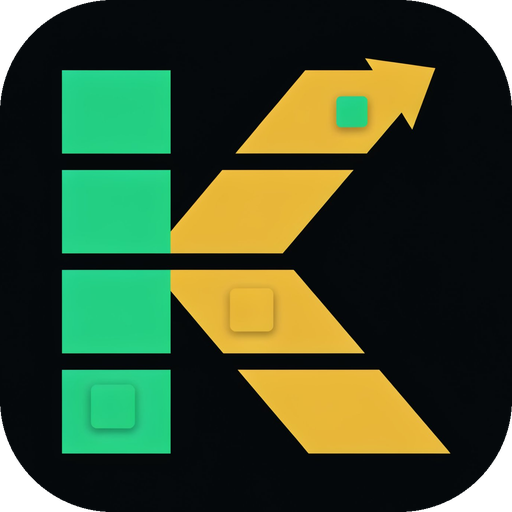
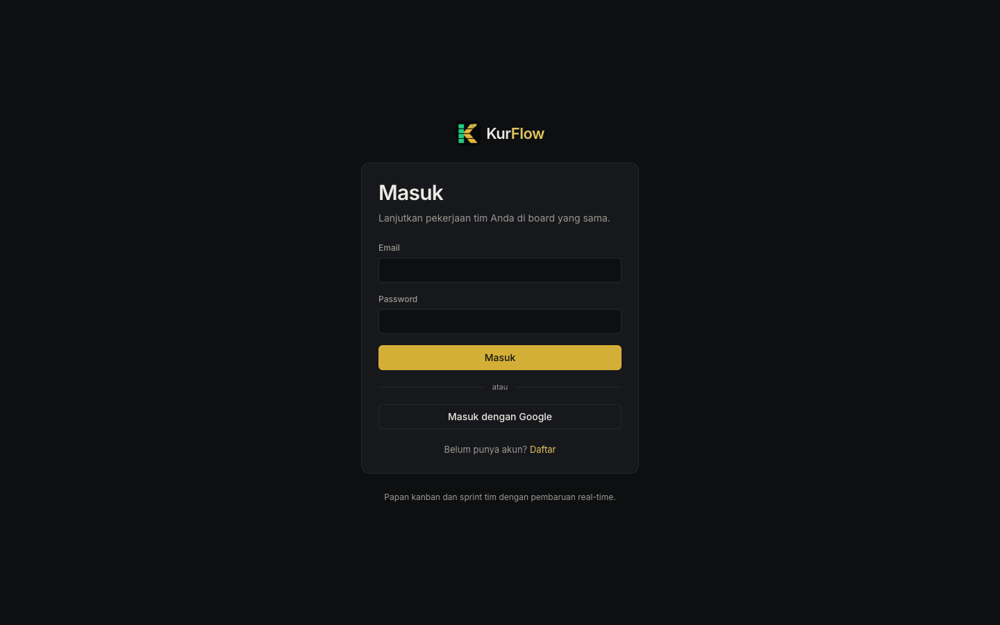
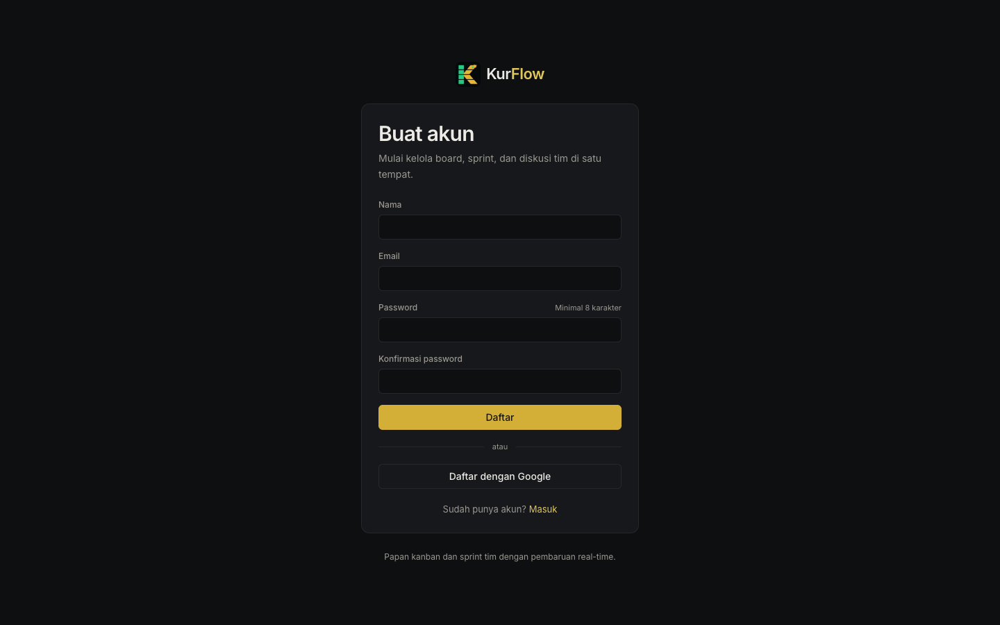
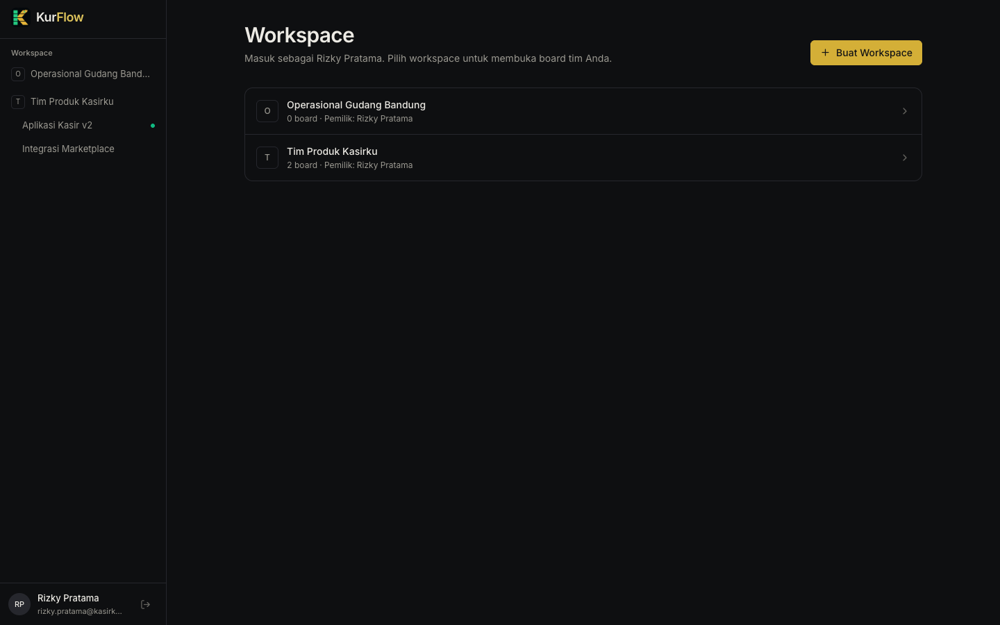
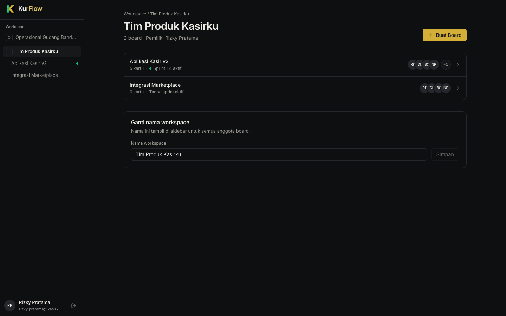
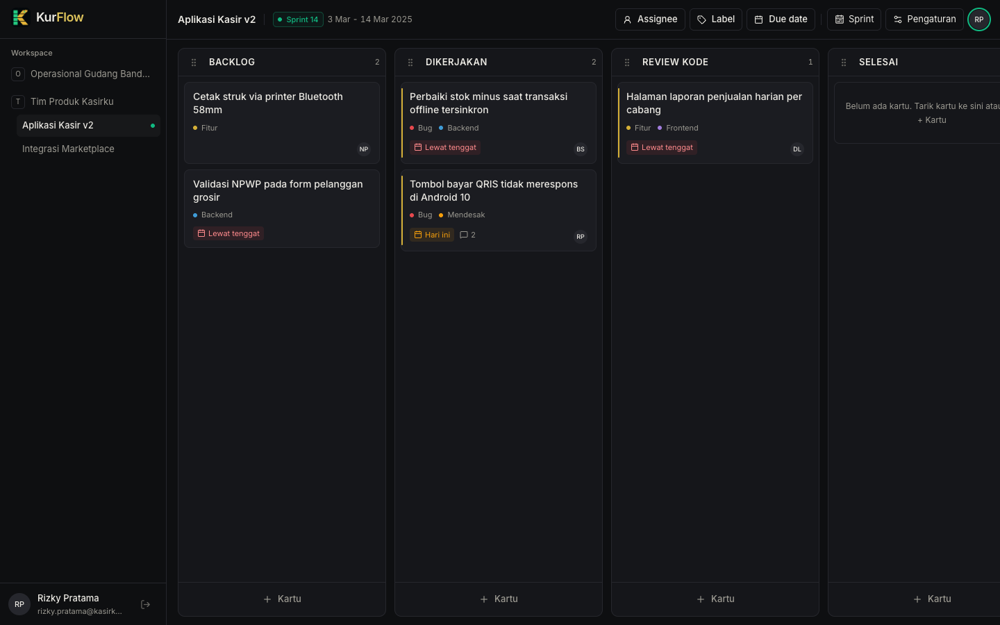
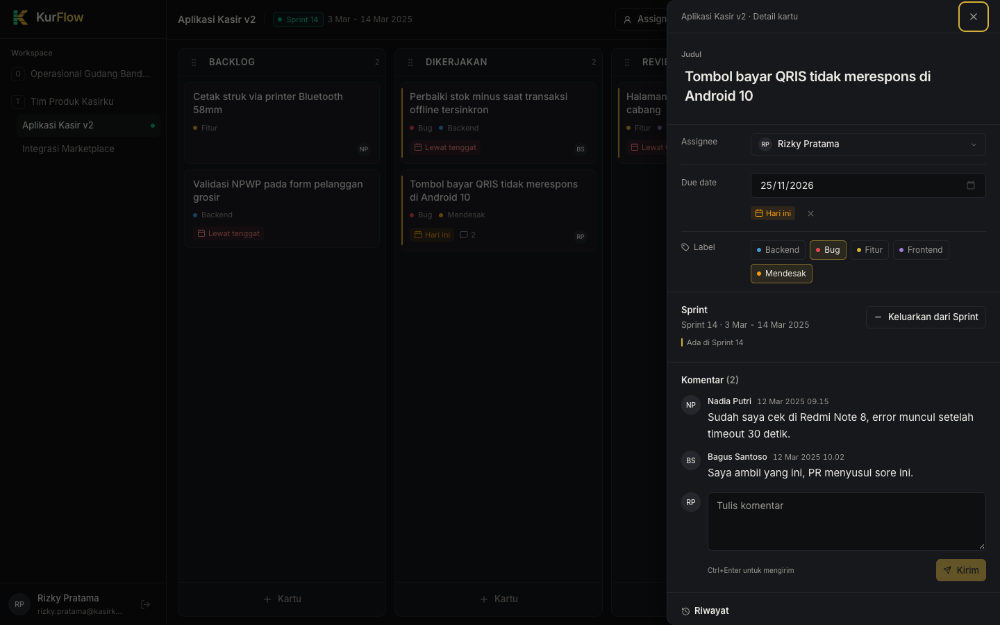
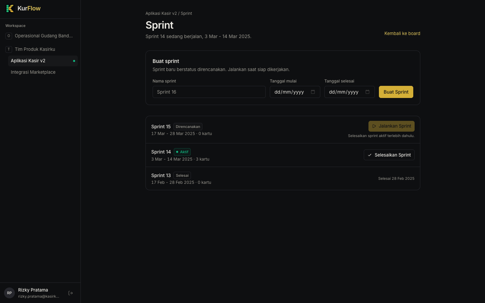
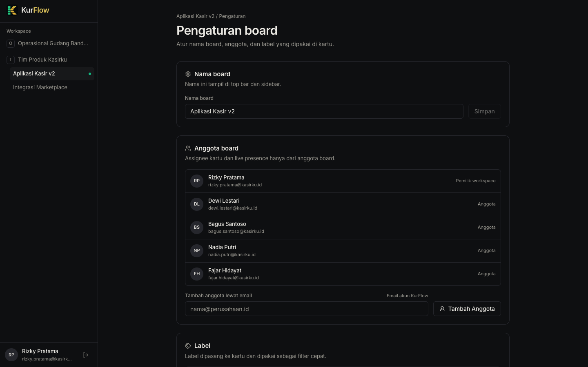

<p align="center">
  
</p>

<h1 align="center">KurFlow</h1>

<p align="center">Papan kanban dan sprint tim dengan pembaruan real-time.</p>

## Tentang

KurFlow adalah aplikasi papan kanban dan sprint untuk tim produk, engineering, dan operasional. Setiap perpindahan kartu, perubahan kolom, komentar baru, dan perubahan sprint disiarkan ke anggota lain yang sedang membuka board yang sama tanpa reload halaman.

Fondasi utamanya:

- Sinkronisasi real-time dengan Laravel Reverb, Laravel Echo, dan `pusher-js`.
- Urutan kartu dan kolom yang presisi dengan fractional indexing.
- Drag-and-drop kartu dan kolom dengan `@dnd-kit`.
- Satu sprint aktif per board, dengan riwayat perpindahan kolom di dalam kartu.

## Fitur Utama

- Workspace dan project board.
- Kolom status kustom: buat, ganti nama, dan urutkan ulang.
- Sprint: rencanakan, jalankan, selesaikan, dan kelompokkan kartu.
- Kartu tugas dengan judul, assignee, due date, dan beberapa label.
- Drag-and-drop kartu dalam kolom maupun antar-kolom.
- Urutan kartu disimpan sebagai rank base-62. Pemindahan hanya memperbarui satu baris kartu.
- Filter cepat berdasarkan assignee, label, dan due date tanpa mengubah rank di database.
- Komentar real-time pada setiap kartu.
- Riwayat perpindahan kolom beserta pelaku dan waktu.
- Live presence anggota yang sedang membuka board.
- Login email dan password, registrasi, dan login Google dengan penautan akun berdasarkan email.
- Sinkronisasi ulang state board setelah koneksi WebSocket tersambung kembali.

## Teknologi

- PHP 8.3, Laravel 11.
- React 18, TypeScript, Inertia.js 2, Vite.
- Tailwind CSS 3, Radix UI, Lucide React, Inter Variable.
- MySQL 8.
- Laravel Reverb, Laravel Echo, `pusher-js`.
- `@dnd-kit/core`, `@dnd-kit/sortable`, `fractional-indexing`.
- Laravel Breeze untuk autentikasi email dan password, Socialite untuk Google.

## Halaman dan Penjelasan

### `/login`

Halaman masuk untuk pengguna terdaftar. Berisi form email dan password, tombol "Masuk dengan Google", serta tautan ke halaman daftar. Setelah berhasil masuk, pengguna diarahkan ke `/workspaces`. Login dibatasi 5 percobaan per menit per email dan IP.



### `/register`

Halaman pendaftaran akun baru. Meminta nama, email, password, dan konfirmasi password. Akun baru langsung masuk dan diarahkan ke `/workspaces`. Akun Google yang belum memiliki password hanya dapat masuk melalui Google.



### `/auth/google/redirect` dan `/auth/google/callback`

Rute teknis tanpa tampilan. Pengguna diarahkan ke halaman persetujuan Google. Saat kembali, KurFlow memeriksa email terverifikasi, menautkan `google_id` ke akun dengan email yang sama, atau membuat akun baru tanpa password. Tombol Google akan kembali ke halaman login dengan pesan yang jelas bila kredensial Google belum diisi.

### `/workspaces`

Daftar workspace milik pengguna dan workspace yang memiliki board tempat pengguna menjadi anggota. Setiap baris menampilkan nama workspace, jumlah board, dan pemilik. Tersedia modal "Buat Workspace" dengan validasi 3 sampai 60 karakter.



### `/workspaces/{workspace}`

Daftar board di dalam workspace. Setiap baris menampilkan jumlah kartu, nama sprint aktif, dan avatar sebagian anggota. Pemilik workspace dapat membuat board dan mengganti nama workspace. Pemilik workspace otomatis menjadi anggota setiap board yang ia buat. Board baru langsung memiliki kolom Backlog, Dikerjakan, Review Kode, dan Selesai.



### `/boards/{board}`

Halaman kerja utama. Top bar menampilkan nama board, sprint aktif beserta rentang tanggal, filter cepat, avatar live presence, tautan Sprint, dan Pengaturan.

Isi board:

- Kolom status horizontal dengan jumlah kartu.
- Handle `GripVertical` untuk mengurutkan kolom.
- Tombol "+ Kolom" di ujung kanan.
- Tombol "+ Kartu" di bawah setiap kolom.
- Kartu menampilkan judul, label, assignee, due date, jumlah komentar, dan penanda emas bila kartu berada di sprint aktif.
- Klik kartu membuka drawer detail. URL berubah menjadi `/boards/{board}?card={id}` tanpa reload.
- Filter assignee, label, dan due date hanya menyaring tampilan di sisi client. Nilai rank di database tidak berubah.
- Klik dan tarik kartu untuk memindahkan posisi. Perubahan langsung tampil untuk pengguna lain di board yang sama.
- Bila koneksi WebSocket terputus, muncul pemberitahuan "Koneksi terputus, mencoba menyambung ulang". State board disinkronkan ulang setelah koneksi kembali.



### Drawer detail kartu

Drawer selebar 480px dari kanan berisi:

- Judul kartu yang dapat diubah langsung.
- Assignee dari anggota board.
- Due date dengan badge "Lewat tenggat" atau "Hari ini".
- Pemasangan dan pelepasan label.
- Tombol masukkan atau keluarkan kartu dari sprint aktif.
- Komentar terurut dari terlama ke terbaru, dengan pengiriman Ctrl+Enter.
- Riwayat perpindahan kolom terbaru di atas, lengkap dengan nama pelaku dan waktu.

Drawer memiliki state loading, empty, dan error. Komentar serta activity log dimuat saat drawer dibuka.



### `/boards/{board}/sprints`

Daftar sprint board beserta status, rentang tanggal, dan jumlah kartu. Pengguna dapat membuat sprint baru, menjalankan sprint berstatus direncanakan, dan menyelesaikan sprint aktif. Tombol "Jalankan Sprint" dinonaktifkan bila sudah ada sprint aktif, dengan pesan "Selesaikan sprint aktif terlebih dahulu." Satu board hanya boleh memiliki satu sprint aktif.



### `/boards/{board}/settings`

Pengaturan board berisi:

- Ganti nama board, hanya untuk Pemilik Workspace.
- Daftar anggota board dan form tambah anggota berdasarkan email akun terdaftar, hanya untuk Pemilik Workspace.
- Daftar label board dan form buat label dengan 6 warna tetap, dapat dilakukan oleh anggota board.

Label harus unik per board tanpa membedakan huruf besar dan kecil. Email anggota harus sudah terdaftar di KurFlow.



## Hak Akses

| Area | Pengguna Login | Anggota Board | Pemilik Workspace |
| --- | :---: | :---: | :---: |
| `/workspaces` | Ya | Ya | Ya |
| Melihat workspace | Hanya jika anggota salah satu board | Ya, board tempat ia anggota | Ya |
| Membuat board dan mengganti nama workspace | Tidak | Tidak | Ya |
| Melihat board dan presence | Tidak | Ya | Ya |
| Membuat, mengganti nama, mengurutkan kolom | Tidak | Ya | Ya |
| Membuat dan memindahkan kartu, komentar, filter | Tidak | Ya | Ya |
| Sprint | Tidak | Ya | Ya |
| Ganti nama board dan kelola anggota | Tidak | Tidak | Ya |
| Membuat label | Tidak | Ya | Ya |

## Data dan Rank

Tabel utama: `users`, `workspaces`, `boards`, `board_members`, `board_columns`, `sprints`, `cards`, `labels`, `card_label`, `card_comments`, `card_activities`.

Aturan penting:

- `rank` memakai alfabet base-62, maksimal 64 karakter, dan collation `utf8mb4_bin`.
- Rank kartu dan kolom dihitung dengan `generateKeyBetween` di client dan `App\Support\RankService` di server.
- Memindahkan kartu hanya mengubah `column_id`, `rank`, dan `updated_at` pada baris kartu tersebut.
- Activity log hanya dibuat saat `column_id` berubah. Nama kolom asal dan tujuan disalin ke activity log.
- Sprint mengikuti urutan `direncanakan` ke `aktif` ke `selesai`.
- Assignee wajib anggota board. Label dan sprint wajib milik board yang sama.
- Filter tidak mengubah rank.

## API Utama

- `GET /api/boards/{board}/state`
- `PATCH /api/cards/{card}/move`
- `POST /api/boards/{board}/cards`
- `PATCH /api/cards/{card}`
- `GET /api/cards/{card}`
- `POST /api/cards/{card}/comments`
- `POST /api/boards/{board}/columns`
- `PATCH /api/columns/{column}`
- `PATCH /api/columns/{column}/move`
- `POST /api/boards/{board}/sprints`
- `POST /api/sprints/{sprint}/start`
- `POST /api/sprints/{sprint}/complete`

Semua endpoint API menggunakan session login, CSRF Laravel, dan Policy keanggotaan board.

## Event Real-Time

Event disiarkan sebagai `ShouldBroadcastNow` ke presence channel `board.{boardId}`:

- `CardCreated`
- `CardUpdated`
- `CardMoved`
- `ColumnCreated`
- `ColumnUpdated`
- `ColumnMoved`
- `CommentCreated`
- `CardActivityCreated`
- `SprintUpdated`

Pengiriman memakai `toOthers()` dengan header `X-Socket-ID` agar pengirim tidak menerima eventnya sendiri dua kali.

## Persyaratan Lokal

- PHP 8.3 atau versi yang kompatibel dengan Laravel 11.
- Composer.
- Node.js dan npm.
- MySQL 8.
- Ekstensi PHP: `pdo_mysql`, `mbstring`, `openssl`, `tokenizer`, `xml`, `ctype`, `json`, `bcmath`, `fileinfo`, `curl`, `intl`.

## Menjalankan Secara Lokal

1. Siapkan database.

```bash
mysql -uroot -e "CREATE DATABASE IF NOT EXISTS kurflow CHARACTER SET utf8mb4 COLLATE utf8mb4_unicode_ci;"
mysql -uroot -e "CREATE DATABASE IF NOT EXISTS kurflow_test CHARACTER SET utf8mb4 COLLATE utf8mb4_unicode_ci;"
```

2. Siapkan environment.

```bash
cp .env.example .env
php artisan key:generate
```

Isi `DB_*` sesuai MySQL lokal. Untuk Reverb, jalankan:

```bash
php artisan reverb:install
```

Perintah itu membuat kredensial Reverb di `.env`. `VITE_REVERB_*` dibaca saat build frontend.

3. Pasang dependency dan migrasi.

```bash
composer install
npm install
php artisan migrate:fresh --seed
npm run build
```

4. Jalankan aplikasi dan Reverb di dua terminal.

```bash
php artisan serve --host=localhost --port=8000
php artisan reverb:start --host=0.0.0.0 --port=8080
```

Buka `http://localhost:8000`. Gunakan `localhost`, bukan `127.0.0.1`, agar cookie sesi, URL aplikasi, dan koneksi Reverb konsisten.

Untuk pengembangan frontend dengan hot reload, jalankan `npm run dev` di terminal terpisah dan tetap jalankan Reverb.

## Akun Demo

Seeder membuat akun berikut. Semua memakai password `password`:

- `rizky.pratama@kasirku.id`
- `dewi.lestari@kasirku.id`
- `bagus.santoso@kasirku.id`
- `nadia.putri@kasirku.id`
- `fajar.hidayat@kasirku.id`

Ganti password dan jangan memakai akun seed di production.

## Pengujian

```bash
npm run typecheck
npm run build
php artisan test
```

Test mencakup aturan autentikasi, rate limit, Google tanpa email terverifikasi, workspace dan board, policy anggota, label, kolom, kartu, assignee, komentar, sprint aktif, rank, dan perpindahan kartu.

Catatan: pada mesin pengembangan dengan PHP 8.5, PHPUnit menampilkan notice deprecation dari konstanta PDO Laravel 11. Notice tersebut bukan kegagalan test.

Pengujian manual real-time dilakukan dengan dua browser berbeda. Skenario yang diverifikasi mencakup presence, kartu, komentar, kolom, sprint, reconnect, pemindahan bersamaan ke posisi yang sama, filter tanpa perubahan rank, dan responsif pada lebar 390, 768, 1024, dan 1440px.

## Build dan Deploy

Build produksi:

```bash
npm run build
php artisan optimize
```

Deploy ke VPS membutuhkan Nginx, PHP-FPM 8.3, MySQL 8, Supervisor, dan sertifikat TLS. Artefak yang sudah disiapkan:

- `deploy/.env.production.example`
- `deploy/nginx-kurflow.conf`
- `deploy/supervisor-kurflow-reverb.conf`
- `deploy/deploy.sh`

Langkah singkat:

1. Salin kode ke server dan arahkan Nginx ke folder `public`.
2. Salin `.env` production, isi `APP_KEY`, database, Reverb, dan Google.
3. Jalankan `php artisan key:generate`.
4. Jalankan build, migrasi, dan optimize.
5. Aktifkan konfigurasi Reverb di Supervisor.
6. Aktifkan HTTPS, lalu uji WebSocket melalui proxy WSS Nginx.

Saat README ini dibuat, aplikasi sudah berjalan dan diuji secara lokal. Deploy VPS belum dieksekusi karena membutuhkan akses server dan domain.

## Struktur Proyek

```text
app/
  Events/              Event broadcast Reverb
  Http/Controllers/    Controller web, auth, dan API
  Http/Middleware/     Shared props Inertia
  Http/Requests/       Validasi server
  Http/Resources/      Bentuk payload API
  Models/              Model Eloquent
  Policies/            Otorisasi board dan workspace
  Services/            State board
  Support/             RankService dan BroadcastNow
database/
  migrations/          Skema Bab 10
  seeders/             Data demo
deploy/                Konfigurasi production
public/
  images/              Logo web
  icons/               Favicon dan ikon browser
  screenshots/         Tangkapan layar untuk dokumentasi
resources/
  brand/               Sumber logo asli
  css/                 Tailwind dan design token
  js/
    components/        Komponen UI dan board
    layouts/           Layout aplikasi dan auth
    lib/               API, filter, format, rank
    pages/             Halaman Inertia
routes/
  web.php              Route halaman dan API
  channels.php         Otorisasi presence channel
tests/                 Feature test dan unit test
```

## Logo dan Ikon

Logo sumber disimpan di `resources/brand/logo_kurflow.jpg`. Logo web yang sudah diproses menjadi PNG transparan ada di `public/images/logo_kurflow.png`, dengan favicon dan apple touch icon di `public/icons/`. Logo tampil di sidebar, halaman autentikasi, dan tab browser.

## Catatan dan Batasan

- Login Google end-to-end memerlukan kredensial OAuth asli.
- Reverb harus berjalan agar pembaruan real-time tersedia. Bila Reverb mati, penulisan data tetap berhasil dan state disinkronkan saat koneksi kembali.
- `php artisan migrate:fresh --seed` menghapus seluruh data dan sesi aktif.
- Build frontend harus diulang setelah mengubah `VITE_REVERB_*` atau konfigurasi domain.
- Laravel 11 memiliki security advisory Composer. Konfigurasi `policy.advisories.block` di `composer.json` dimatikan agar dependency dapat dipasang. Tinjau ulang sebelum rilis publik.
- PHP lokal versi 8.5 menghasilkan notice deprecation pada test. Target production adalah PHP 8.3.
- MySQL lokal dapat berbeda versi dari MySQL 8 production. Skema sudah memakai tipe, indeks, dan collation yang ditentukan PRD.
